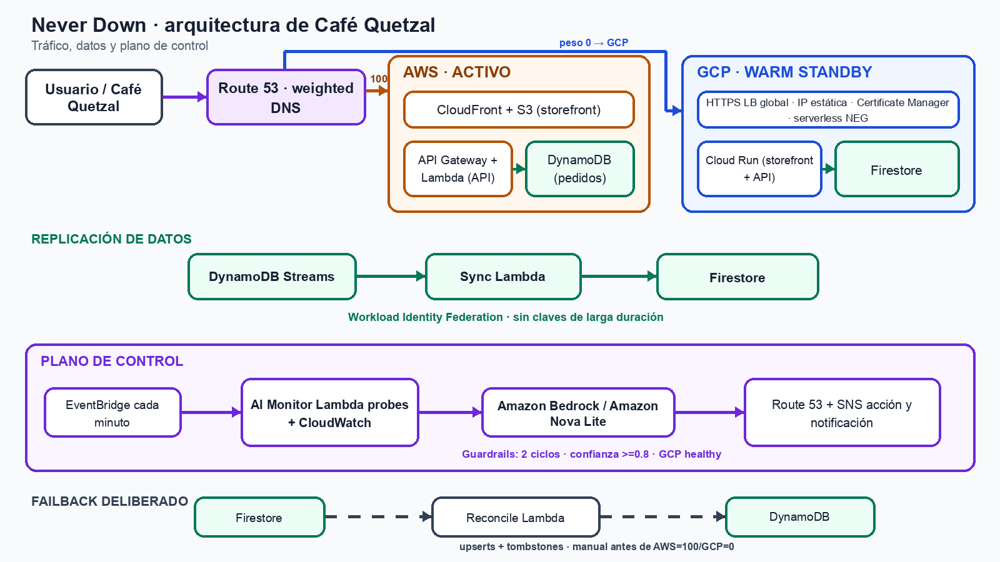

# Never Down 🛡️

**Failover multicloud AWS→GCP decidido por un agente de IA**

DRP (Disaster Recovery Plan) multicloud donde AWS es el cloud primario y GCP el
warm standby. Un agente de IA con Amazon Bedrock monitorea la salud de ambos
clouds, analiza métricas en tiempo real y — cuando detecta degradación
sostenida — ejecuta el failover a GCP con razonamiento explícito, no con
health checks booleanos.

**App del demo:** ☕ **Café Quetzal** — el sistema de pedidos online de una
cafetería. Cuando AWS se cae, los pedidos siguen entrando desde GCP; nadie deja
de vender café. Cada pedido registra qué nube lo tomó (`served_by`), así el
failover en vivo se ve al instante: `aws-lambda` → `gcp-cloud-run`.

---

## Cómo usar este repo

Este es el código de la charla **"Never Down"**, presentada en el **AWS
Community Day Guatemala 2026** por **Hernán Villavicencio** (AWS User Group
Quito). Puedes contactarlo en
[linkedin.com/in/hvillavicencio](https://linkedin.com/in/hvillavicencio).

El repo contiene la app (AWS + GCP), el AI Monitor, el Terraform de toda la
infraestructura y los scripts usados para ensayar el failover en vivo. Para
desplegarlo en tu propia cuenta:

1. Clona el repo.
2. Copia `terraform/terraform.tfvars.example` a `terraform/terraform.tfvars`
   y completa los valores con los de tu cuenta (ver sección "Cuentas /
   entorno" abajo).
3. Sigue las fases descritas en "Fases de construcción" para desplegar primero
   AWS, luego GCP, luego la replicación y finalmente el AI Monitor.

> ⚠️ **Este es un proyecto de demostración educativa. No está listo para
> producción sin agregar autenticación/autorización, rate limiting,
> aislamiento del plano de control y pruebas de carga/caos adicionales.**

## Arquitectura

```
                      <TU_DOMINIO>
                                │
                        Route 53 (weighted)
                    ┌───────────┴───────────┐
              weight=100                weight=0
                    │                       │
        ┌───────────▼──────────┐   ┌────────▼─────────┐
        │  AWS — PRIMARIO      │   │  GCP — STANDBY    │
        │  API Gateway         │   │  Cloud Run        │
        │  Lambda (app)        │   │  (misma app)      │
        │  DynamoDB            │   │  Firestore        │
        └───────────┬──────────┘   └──────────────────┘
                    │
        ┌───────────▼───────────────────────────────┐
        │  AI Health Monitor (cada 60s)              │
        │  Lambda → CloudWatch metrics → Bedrock     │
        │  Decide: OK | DEGRADED | FAILOVER          │
        │  Si FAILOVER: cambia pesos Route 53 + SNS  │
        └────────────────────────────────────────────┘
```



## Cuentas / entorno

Reemplaza estos placeholders con los valores de tu propia cuenta antes de
desplegar. Nunca subas tus valores reales a un repo público.

| Recurso        | Valor                                                        |
|----------------|---------------------------------------------------------------|
| AWS profile    | `<TU_PERFIL_AWS>` — cuenta `<TU_CUENTA_AWS>` (usar AWS_PROFILE) |
| AWS region     | `us-east-1`                                                    |
| GCP project    | `<TU_PROYECTO_GCP>`                                            |
| GCP region     | `us-central1`                                                  |
| Bedrock model  | `amazon.nova-lite-v1:0`                                        |
| Hosted zone    | `<TU_HOSTED_ZONE_ID>` (tu dominio en Route 53)                 |

Cómo obtener tus valores:

```bash
# Tu AWS account ID
aws sts get-caller-identity --query Account --output text

# El hosted zone ID de tu dominio en Route 53
aws route53 list-hosted-zones-by-name --dns-name <tu-dominio> \
  --query "HostedZones[0].Id" --output text

# Tu proyecto GCP activo
gcloud config get-value project

# El invoke URL del API Gateway (tras desplegar Terraform)
terraform output -raw aws_api_endpoint
```

Los scripts en `scripts/` no traen ningún endpoint ni proyecto hardcodeado:
exigen las variables de entorno `AWS_API_URL` (invoke URL del API Gateway,
usado por `simulate-failure.sh`, `restore.sh` y `failback.sh`) y `GCP_PROJECT`
(tu proyecto GCP, usado por `build-gcp.sh` y `deploy-gcp.sh`).

Siempre ejecuta Terraform forzando el perfil de AWS correcto:

```bash
AWS_PROFILE=<TU_PERFIL_AWS> terraform apply
```

## Estructura

```
never-down/
├── app/
│   ├── aws/handler.py        # Lambda — Café Quetzal (pedidos sobre DynamoDB)
│   ├── gcp/                  # Cloud Run — misma app sobre Firestore
│   │   ├── main.py
│   │   ├── requirements.txt
│   │   └── Dockerfile
│   ├── monitor/
│   │   └── health_monitor.py # AI Monitor: métricas → Bedrock → failover
│   └── sync/                 # Replicación AWS→GCP (DynamoDB Streams → Firestore)
│       ├── sync_handler.py
│       ├── reconcile_handler.py
│       ├── Dockerfile
│       ├── requirements.txt
│       └── gcp-cred-config.json.example
├── terraform/                 # AWS + GCP en un solo apply
├── web/index.html             # Frontend del demo
├── docs/arquitectura-builder-center.png
└── scripts/
    ├── simulate-failure.sh    # Mata la Lambda en vivo
    ├── watch.sh               # curl en loop mostrando served_by
    ├── restore.sh             # revive AWS + pesos a AWS + reset del monitor
    ├── failback.sh            # failback con reconciliación Firestore → DynamoDB
    ├── deploy-gcp.sh          # reconstruye y redespliega Cloud Run
    ├── build-gcp.sh           # build de la imagen de Cloud Run
    ├── build-sync.sh          # build de la imagen de la Lambda de sync
    └── setup-wif.sh           # configura Workload Identity Federation (GCP)
```

## API (Café Quetzal)

| Método | Ruta          | Descripción                                            |
|--------|---------------|--------------------------------------------------------|
| GET    | `/health`     | Estado + qué nube responde (`served_by`)               |
| GET    | `/menu`       | Menú de la cafetería                                   |
| GET    | `/orders`     | Lista de pedidos                                       |
| POST   | `/orders`     | Crea pedido `{"customer","items":[{"sku","qty"}]}`     |
| GET    | `/orders/{id}`| Detalle de un pedido                                   |

SKUs del menú: `esp` Espresso · `amer` Americano · `cap` Cappuccino ·
`lat` Latte · `moc` Mocha · `cold` Cold Brew

## Fases de construcción

- Fase 1 — App AWS (Lambda + DynamoDB + API Gateway)
- Fase 2 — App GCP (Cloud Run sirve front + API, Firestore)
- Fase 3 — Replicación DynamoDB Streams → Lambda → Firestore (WIF, sin llaves)
- Fase 4 — Subdominios + Route 53 weighted + custom domains
      · AWS: front→CloudFront, api→API GW (TLS ACM)
      · GCP: LB HTTPS externo → Cloud Run (TLS via Certificate Manager DNS-auth, IP estática)
      · Failover = cambio de pesos Route 53 (var aws_weight / gcp_weight)
- Fase 5 — AI Monitor (EventBridge + Bedrock + SNS) que voltea ambos registros
- Fase 6 — Scripts de demo + ensayo end-to-end
      · scripts/watch.sh — loop de curl en vivo (resolución DNS fresca, no depende del navegador)
      · scripts/simulate-failure.sh — mata la Lambda (el "kill AWS en vivo")
      · scripts/restore.sh — revive AWS + pesos a AWS + reset del monitor
- Fase 7 — Prueba end-to-end + ensayo cronometrado

## Ensayo del demo (comandos reales)

```bash
export AWS_API_URL=<TU_AWS_API_ENDPOINT>   # terraform output -raw aws_api_endpoint

# Terminal 1: testigo en vivo (NO depende de caché del navegador)
./scripts/watch.sh

# Terminal 2: el momento épico
./scripts/simulate-failure.sh

# Esperar unos minutos. El AI Monitor decide FAILOVER (ver logs):
aws logs tail /aws/lambda/never-down-monitor --follow --profile <TU_PERFIL_AWS>

# Al terminar el demo:
export ZONE=<TU_HOSTED_ZONE_ID>
./scripts/restore.sh
```

En un ensayo documentado, la decisión del agente tardó ~61s y la confirmación
pública ~97.5s. Estos tiempos dependen de la configuración de ciclos del AI
Monitor y de las condiciones de red del momento — no se presentan como una
garantía de RTO ni como un SLA.

### Después de tocar el frontend o la app de GCP

Si editas `web/index.html` o `app/gcp/main.py`, GCP se queda con la versión vieja
hasta que reconstruyas y redespliegues (Terraform NO sincroniza esto):

```bash
./scripts/deploy-gcp.sh
```

## Failback con reconciliación

La réplica es **unidireccional AWS→GCP**. Si el tráfico estuvo en GCP y
entraron pedidos nuevos ahí, esos pedidos NO existen en DynamoDB. Si volvieras
el tráfico a AWS sin más, el cliente los "perdería" de vista.

Por eso, para volver a AWS después de un failover real, usar `failback.sh` en vez
de `restore.sh`: reconcilia primero (Firestore → DynamoDB) y LUEGO mueve el tráfico.

```bash
export ZONE=<TU_HOSTED_ZONE_ID>
export AWS_API_URL=<TU_AWS_API_ENDPOINT>   # terraform output -raw aws_api_endpoint
./scripts/failback.sh
```

Qué hace: 1) invoca la Lambda `never-down-reconcile` (copia todo Firestore → DynamoDB,
vía WIF, sin llaves) · 2) revive la Lambda de AWS · 3) pesos → AWS=100 · 4) resetea
el estado del monitor.

**Simetría resuelta con tombstones**: al borrar un pedido en GCP (mientras es
primario), se deja un "tombstone" en la colección `never-down-deletions`. La
reconciliación de `failback.sh` aplica ALTAS (upsert de lo vivo en Firestore) y
BAJAS (borra en DynamoDB los IDs con tombstone, y limpia el tombstone ya usado).
Funciona en ambas direcciones: AWS→GCP en tiempo real (Streams) y GCP→AWS en el
failback (reconciliación).

`restore.sh` sigue existiendo como el "reset de emergencia" (sin reconciliar) para
cuando el failover fue solo una prueba sin datos reales que rescatar.

⚠️ **Lección aprendida**: el badge del navegador puede quedarse "pegado" por caché DNS
del propio navegador incluso después de que el TTL expiró. Para el escenario, confiar
en `watch.sh` (curl fresco) como evidencia, no solo en el storefront abierto.

## Replicación de datos (warm standby)

```
Pedido nuevo → DynamoDB → DynamoDB Streams → Lambda sync → Firestore (GCP)
                                                  │
                                    auth vía Workload Identity Federation
                                    (rol de AWS federado a SA de GCP, sin llaves)
```

- **RPO**: del orden de segundos. Los pedidos están en GCP antes de cualquier caída.
- **Dirección**: AWS→GCP (cubre el failover). El failback GCP→AWS queda documentado
  como reconciliación posterior.

## Workload Identity Federation (GCP)

`app/sync/gcp-cred-config.json.example` muestra la estructura del archivo de
credenciales WIF (sin llaves estáticas) que usa la Lambda de sync para
autenticarse contra Firestore. Genera el tuyo con `scripts/setup-wif.sh`
(exporta `PROJECT`, `PROJECT_NUMBER` y `AWS_ACCOUNT` con tus propios valores
antes de ejecutarlo) — el archivo real `gcp-cred-config.json` nunca debe
subirse al repo (ya está en `.gitignore`).
